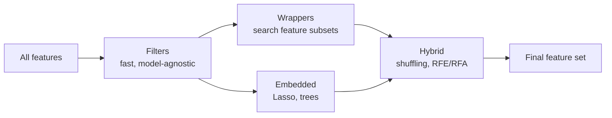

<div align="center">

# 🎯 Feature Selection for Machine Learning

**29 notebooks covering filter, wrapper, embedded and hybrid feature selection methods**

<p>
  
  
  
  
</p>

</div>

---

## 📌 Overview

Choosing the right features makes models simpler, faster, easier to explain and often more accurate. These notebooks implement and compare the main families of feature selection techniques on real datasets, with a review notebook and a reusable pipeline at the end of each family.

> 📚 These are my study notebooks from an online feature selection course, shared for learning and reference.

## 🧭 What's inside

| Family | Methods | Notebooks |
|---|---|---|
| **Basic filters** | Constant, quasi-constant and duplicated features | `03.x` |
| **Correlation** | Removing correlated features, combined pipeline | `04.x` |
| **Statistical filters** | Information gain (mutual information), Fisher score (chi²), univariate tests (ANOVA F-test), univariate ROC-AUC, a method used in the KDD Cup | `05.x` |
| **Wrapper methods** | Step forward, step backward and exhaustive feature selection (mlxtend) | `06.x` |
| **Embedded: regularization** | Lasso, filter + Lasso pipeline | `07.x` |
| **Embedded: linear models** | Logistic and linear regression coefficients, effect of regularization | `08.x` |
| **Embedded: trees** | Random forest importance, recursive selection with random forests, gradient boosting importance | `09.x` |
| **Hybrid methods** | Feature shuffling (permutation importance), recursive feature elimination and addition | `11.x` |



## 📂 Repository structure

```
Feature-selection-notebooks/
├── 03.2_Constant_features.ipynb … 03.5_Basic_methods_review.ipynb
├── 04.2_Correlation.ipynb · 04.3_Basic_methods_plus_correlation_pipeline.ipynb
├── 05.2_Information_gain.ipynb … 05.7_Bonus_method_used_in_KDD_competition.ipynb
├── 06.1_Step_forward.ipynb · 06.2_Step_backward.ipynb · 06.3_Exhaustive_feature_selection.ipynb
├── 07.x_Lasso… · 08.x_Linear_models… · 09.x_Trees…
└── 11.01_Feature_shuffling.ipynb · 11.02/11.03_Hybrid_Recursive…
```

## 🚀 Getting started

```bash
git clone https://github.com/hamidghasemi69/FeatureSelection.git
cd FeatureSelection
pip install scikit-learn pandas numpy matplotlib seaborn mlxtend jupyter
jupyter notebook
```

> The notebooks use public Kaggle datasets (Santander Customer Satisfaction, BNP Paribas Cardif claims, House Prices and Titanic), saved as `santander.csv`, `paribas.csv`, `houseprice.csv` and `titanic.csv`. Download them separately.

## 👤 Author

**Hamidreza Ghasemi** · Principal Data Scientist @ Arizona State University

[](https://hamidghasemi69.github.io)
[](https://www.linkedin.com/in/hamidghasemi69/)
[](https://github.com/hamidghasemi69)

<sub>If you find this project useful, consider giving it a ⭐</sub>
